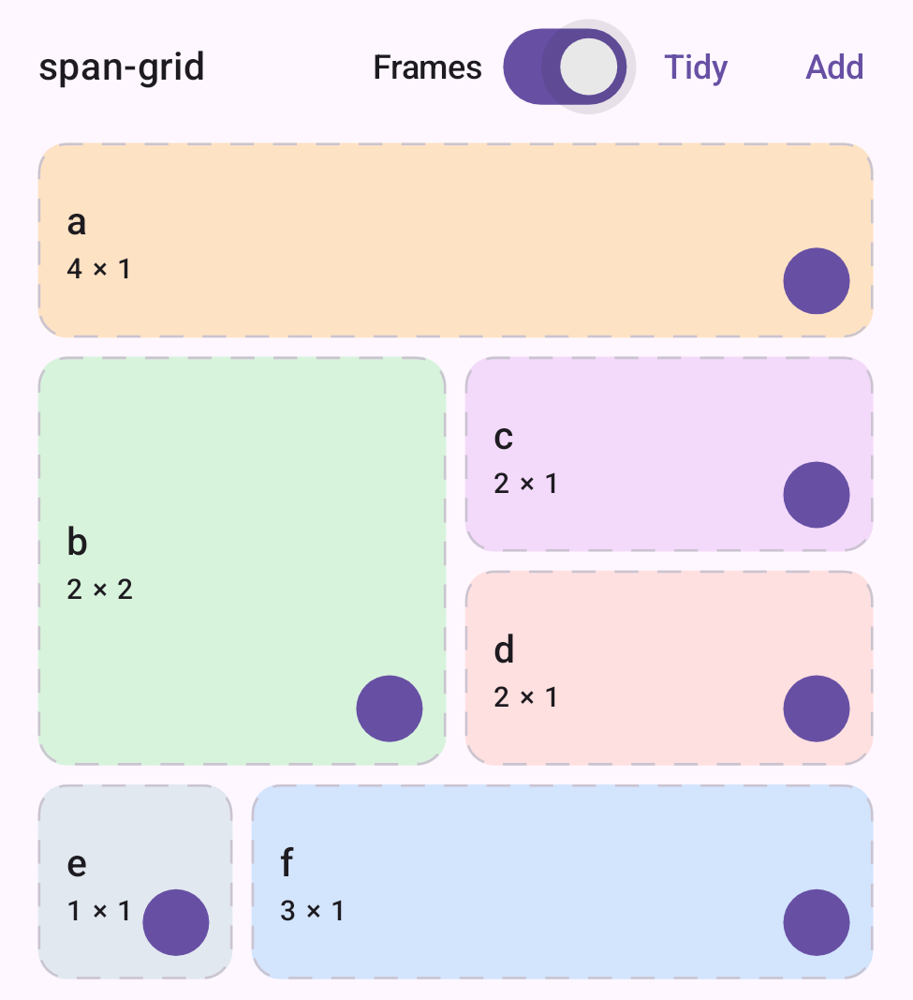

# span-grid

A Compose grid that supports **row spans** — the one thing `LazyVerticalGrid` cannot do and
`LazyVerticalStaggeredGrid` can only fake with full-line spans.

Four fixed columns, absolute cell coordinates, items that are 1×1, 2×2, full-width × 3 rows, or
anything else the host allows. Drag to move, drag the corner to resize, and the board answers with
a swap, a free landing or a push — never an overlap.



Straight out of the preview panel: `DemoLightPreview`, i.e. the `demo` module's `DemoContent` at
384 × 440 dp. `DemoDarkPreview` is the same board with `uiMode = UI_MODE_NIGHT_YES`.

```
span-grid-core      placement rules — pure Kotlin, no Android, no Compose
span-grid-compose   the board layout, the drag state machine, the edit chrome
demo                a runnable sample host
```

## Why not a lazy grid

`LazyVerticalGrid`'s `span` is a column range; there is no row span, and placement is strict flow
order, so an item at row 1 column 2 with a hole above it cannot be expressed. This library places
children at absolute cells with a hand-written `Layout` — which is what a launcher does anyway.
Laziness is not missed: a dashboard has tens of tiles, not thousands.

## Usage

```kotlin
// settings.gradle.kts
repositories {
    maven("https://jitpack.io")
}
```

```kotlin
// build.gradle.kts
dependencies {
    implementation("com.github.wraphex.span-grid:span-grid-compose:0.1.0")
}
```

The host supplies the board shape and the tile size policy; the library only applies them:

```kotlin
val spec = GridSpec(
    columns = 4,
    maxRows = 3,
    boundsOf = { id -> SpanBounds(min = GridSpan(1, 1), max = GridSpan(4, 3)) }
)

WidgetGrid(placements = items.map { GridPlacement(it.column, it.row, it.span) }) {
    items.forEach { item -> key(item.id) { MyTile(item) } }
}
```

`GridBoard` holds the rules as pure functions — `pack`, `tidy`, `move`, `resize`, `append`,
`insert`, `compactRows` — and returns a new list every time, so it is testable without a device:

```kotlin
items = GridBoard.move(items, id = "lamp", column = 2, row = 1, spec = spec)
items = GridBoard.resize(items, id = "lamp", span = GridSpan(2, 2), spec = spec)
items = GridBoard.tidy(items, spec)
```

## The span rhythm

`allowedSpans` only offers spans that tile without leaving a one-cell hole: 1 column × 1 row,
2 columns at any height, or full width. A host that genuinely wants a 1×2 box widens its own
`SpanBounds` — the rule is derived from bounds, never hand-listed.

## Development

```bash
./gradlew :span-grid-core:test        # the placement rules, plain JUnit, no device
./gradlew :demo:installDebug          # the sample host
./gradlew publishToMavenLocal         # both libraries into ~/.m2
```

The Android modules need an SDK: set `ANDROID_HOME`, or drop a `local.properties` with
`sdk.dir=...` in this directory (it is gitignored). The Compose versions are pinned rather than
BOM-managed on purpose: `span-grid-compose` is built against Compose 1.10 / `compileSdk 36` so it
stays consumable from apps that have not moved to API 37, and a published POM has to carry real
versions anyway.

## License

GPL-3.0. See [LICENSE](LICENSE).
